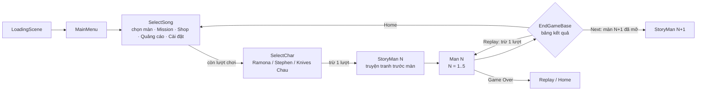

# BeatRun — Tài liệu kỹ thuật & Đảm bảo chất lượng

*Dùng cho phần Tài liệu kỹ thuật và Đảm bảo chất lượng trong báo cáo tốt nghiệp. Nền tảng: Unity 6 (6000.3), Android.*

---

## 1. Luồng vận hành

- **Chuyển cảnh:** mọi lần đổi scene đều tối dần rồi sáng dần (`SceneFader`). Trong lúc chuyển không nhận thêm thao tác bấm.
- **Điều hướng:** `LevelFlow` gom luật Replay / Next / Home cho mọi màn, nhận diện màn theo tên `ManN` / `StoryManN`.
- **Tutorial:** là scene riêng, hiện chưa nằm trong luồng phát hành.

## 2. Dữ liệu người chơi (`PlayerData.json`, `Application.persistentDataPath`)

| Nhóm | Trường | Ý nghĩa |
|---|---|---|
| Tiền tệ | `currency.coin`, `currency.diamond`, `totalCoinEarned`, `totalDiamondEarned` | Số dư và tổng đã kiếm (dùng cho thành tựu) |
| Tiến trình | `progression.unlockedLevels` | Các màn đã mở (màn 1 luôn mở) |
| Nhân vật | `unlockedCharacters` | Nhân vật đã mở (nhân vật 0 luôn mở) |
| Kỷ lục | `levelRecords[] { levelId, highScore, maxCombo }` | Điểm và combo cao nhất mỗi màn |
| Thống kê | `comboStats { good, great, perfect }` | Tổng số lần đạt từng mức |
| Lượt chơi | `playTurn { turns, lastRegenTicks, totalPlays }` | 20 lượt tối đa, hồi 1 lượt / 5 phút, tính cả khi tắt game |
| Nhiệm vụ ngày | `dailyMission { day, levelsCompleted, perfectHits, bestCombo, claimed[] }` | 3 nhiệm vụ, tự làm mới khi sang ngày mới |
| Thành tựu | `claimedAchievements[]` | Thành tựu đã nhận thưởng |

Cài đặt âm thanh lưu riêng trong PlayerPrefs: `SETTING_BGM`, `SETTING_SFX`.

**An toàn dữ liệu:**
- Ghi file qua bản tạm `.tmp` rồi thay thế trong một bước.
- Nếu máy tắt giữa lúc lưu, lần sau tự khôi phục từ bản tạm.
- File hỏng được sao lưu (`.corrupt_<thời gian>`) trước khi tạo save mới.
- Save cũ thiếu trường mới được bổ sung giá trị mặc định khi đọc, không xoá tiến trình.
- Nhiệm vụ ngày chỉ làm mới khi **sang ngày mới**. Chỉnh đồng hồ lùi không giúp nhận thưởng lại.
- `PlayerDataManager` luôn tồn tại dù vào game từ scene nào (tự khởi tạo, không tạo trùng).

## 3. Cơ chế kỹ thuật nổi bật

### 3.1 Đồng bộ nhịp beat MIDI
- **Đọc nhạc:** file MIDI được đọc lúc chạy (track, tempo, độ dài nốt), lọc theo độ khó và chia vào 2 lane.
- **Đồng hồ bài hát:** nhạc được hẹn giờ phát bằng `AudioSource.PlayScheduled` theo đồng hồ âm thanh `AudioSettings.dspTime`. Mọi nốt tính vị trí từ `SongTime = dspTime − mốc bắt đầu`, nên không bị trôi nhịp theo FPS.
- **Pause / Game Over:** `SongClock` đóng băng `SongTime` và dời mốc bắt đầu khi tiếp tục, nên không lệch nhịp. Chuyển sang app khác thì game tự pause.
- **Đếm ngược:** READY / GO dùng chung một lớp `RhythmCountdown`. Nhạc được lên lịch khi bắt đầu đếm, chữ GO tắt đúng lúc nhạc vào.

### 3.2 Chấm điểm (`ComboSystem` + `ScoreSystem`)
- **Mức chấm:** Good 100, Great 200, Perfect 300. Mức được tính một trong hai cách:
  - Theo chuỗi combo: 1–4 nốt = Good, 5–9 = Great, từ 10 = Perfect.
  - Theo **độ lệch thời gian** so với nốt MIDI: ≤ 60 ms = Perfect, ≤ 120 ms = Great.
- **Một chỗ duy nhất:** mọi màn báo trúng/trượt về cùng một nơi, nên không bao giờ cộng trùng.
- **Bảng kết quả (`EndGameBase`, dùng chung):**
  - Sao 1: điểm ≥ 60% điểm tối đa của lượt chơi.
  - Sao 2: combo ≥ 25% số nốt (tối đa 100).
  - Sao 3: hạ boss.
  - Thưởng 200 / 500 / 1000 coin theo số sao. Kỷ lục và nhiệm vụ ngày được lưu trong một lần ghi file.

### 3.3 Boss dùng chung một luật
- Máu boss = số nốt của bài. Mỗi nốt đánh trúng trừ 1 máu.
- Màn 1: đòn Fever bắn đạn trừ thêm vào cùng thanh máu.
- Mỗi loại boss phát một sự kiện "bị hạ" riêng (Man1 `BossHealth`, Man2 `BossController2`, Man3 `SubmarineController`), bảng kết quả nghe đúng sự kiện của màn mình.
- Thanh máu tự tạo nếu prefab chưa có; khi boss chết, thanh máu mờ dần rồi biến mất.
- Màn 1: boss chưa bắn trong 10 giây đầu để người chơi mới làm quen.

### 3.4 Chuyển cảnh & luồng
- **Fade:** `SceneFader` tối dần 0,35 s rồi sáng dần, chạy theo thời gian thật nên vẫn hoạt động khi game đang dừng.
- **Chặn bấm đúp:** trong lúc chuyển, các thao tác bấm bị chặn để không trừ lượt hai lần.
- **Trả lại trạng thái:** game chỉ chạy lại (timeScale, âm thanh) sau khi scene mới đã load, nên không có nhạc chạy thoáng qua.

### 3.5 Âm thanh
- **Nhạc nền menu** (`BackgroundMusic`): một bản duy nhất sống qua các scene, tự tắt ở scene truyện/màn chơi, fade in/out.
- **Tiếng nút và tiếng gameplay** (`GameplaySfx`): âm 2D, giới hạn số tiếng phát cùng lúc, không phát chồng cùng một âm trong 30 ms, dừng theo Pause.
- **Cài đặt:** nút Nhạc / Âm thanh lưu vào `AudioPrefs` và áp dụng ngay.

### 3.6 Kinh tế & quảng cáo
- Xem hết quảng cáo có thưởng được +500 coin (giới hạn 5 lần/ngày, cách nhau 5 phút).
- Callback của SDK quảng cáo được chuyển về luồng chính của Unity trước khi cộng thưởng (tránh crash trên Android).
- Mở màn bằng coin. Lượt chơi tự hồi theo thời gian thực.

### 3.7 Công cụ cho nhóm (Unity Editor)
- **MIDI Chart Tool:** xem track, lọc nốt theo channel / cao độ / thời gian / mật độ, xem biểu đồ mật độ, xuất MIDI sạch hoặc CSV.
- **Animator nhân vật:** tạo clip từ sprite sheet theo số frame, chuẩn hoá tham số và trạng thái Animator cho 3 nhân vật.

## 4. Đảm bảo chất lượng

| Hạng mục | Cách kiểm tra |
|---|---|
| Biên dịch | Unity Editor + `dotnet build` cho Assembly-CSharp và Assembly-CSharp-Editor: 0 lỗi |
| Tham chiếu scene | Rà toàn bộ GUID trong các scene build: không còn script hay asset bị mất |
| Luồng | Replay / Next / Home ở mọi màn, hết lượt, màn bị khóa, bấm liên tục khi đang chuyển cảnh |
| Nhịp | Pause/Resume giữa bài, chuyển app rồi quay lại, Game Over |
| Điểm | Mỗi nốt chỉ cộng một lần; số Miss đúng; sao tính theo số nốt thật |
| Dữ liệu | Save cũ thiếu trường mới, đổi ngày, file save hỏng, tắt app giữa chừng |
| Âm thanh | Tắt/bật Nhạc và Âm thanh, giữ nguyên sau khi mở lại game |

**Lỗi lớn đã phát hiện và sửa** (ghi vào phần QA):
- Cộng điểm/combo 2 lần mỗi nốt (Man1, Man2).
- Pause làm lệch nhịp nhạc.
- Vẫn bấm trúng nốt khi đang dừng.
- Bảng thưởng vẫn hiện khi đã thua.
- Quảng cáo không trả thưởng.
- LevelData của Màn 3 bị mất tham chiếu nên màn không có nhạc.
- Prefab nốt giữ (Hold) của Màn 1 bị xoá nhầm.
- 2 font chữ còn dấu xung đột merge.
- Callback quảng cáo chạy ngoài luồng chính.
