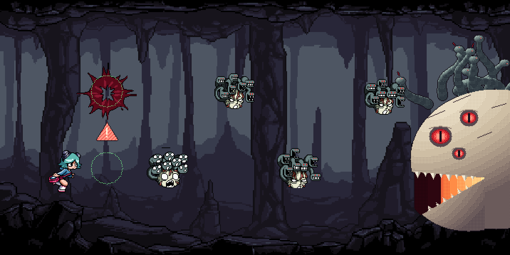
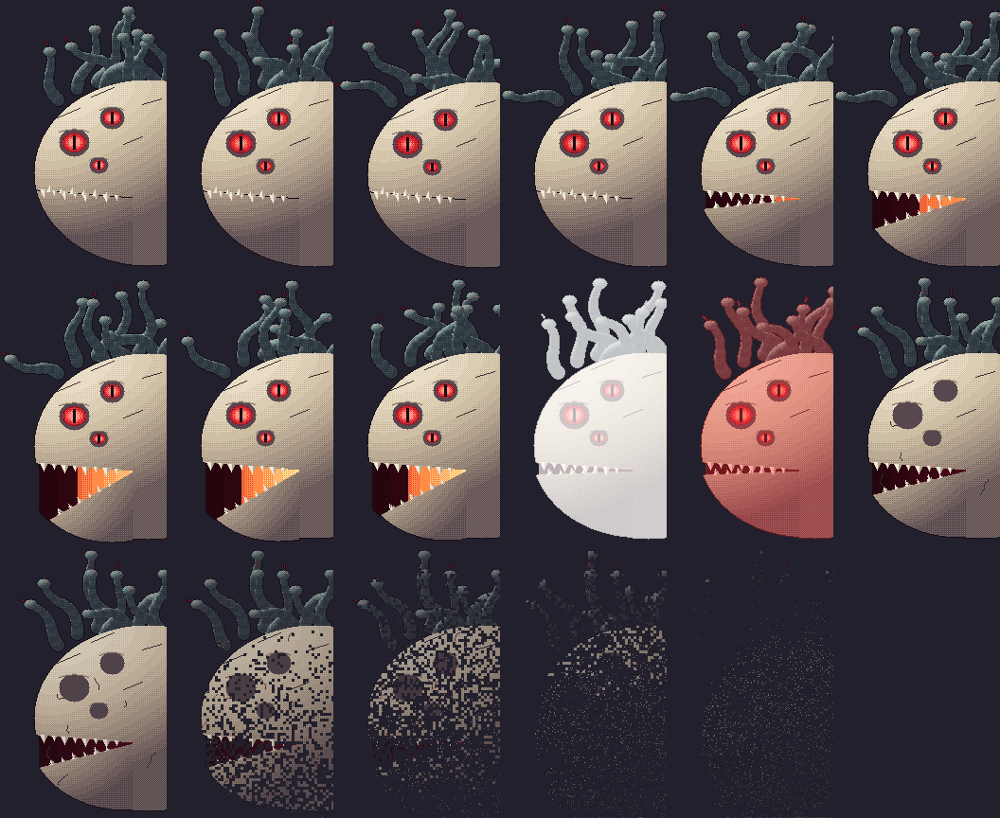
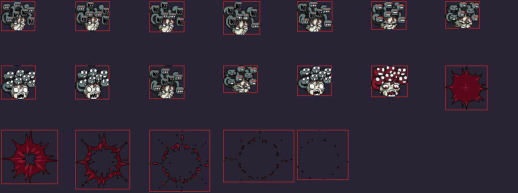

# Bộ asset kẻ địch Màn 4 — The Mysterious Cave


*Mockup đúng tỉ lệ camera Man4: orthographic 5.6, PPU 32, khung 716×358 px. Ảnh phóng to ×2.*

## 1. Cơ chế (theo thiết kế của Long)
- Bộ ba đi qua hang động. **Quái mẹ "Mother Maw"** là nửa cái đầu khổng lồ ở mép phải màn hình.
- Quái mẹ **há miệng theo nhịp** rồi **nhả quái con** (đầu rắn MedusaHead). Quái con lao từ phải sang trái trên 1 trong 2 lane.
- Quái con **phát nổ tại hit point**. Người chơi dùng nút **lên / xuống** để né sang lane còn lại. Đứng sai lane thì bị trừ máu và mất combo.
- **Thời điểm nổ = nốt MIDI**: nhạc quyết định lúc quái con chạm hit point, nên người chơi né theo đúng nhịp.

| Nhịp (tính ngược từ nốt) | Quái mẹ | Quái con | UI |
|---|---|---|---|
| −(bay + 0,25 s) | trigger `Attack` → **Open** (há miệng, ánh lửa trong họng) | — | — |
| −bay | **Spit** (nhả) | xuất hiện ở miệng, chạy **Fly** | — |
| −0,4 s | — | trigger `Alarm` (mặt hoảng sợ) | `LaneWarning` nhấp nháy trên lane đó |
| 0 (nốt MIDI) | — | trigger `Explode` → **Burst** tại hit point | trừ máu nếu người chơi ở lane đó |
| người chơi hạ quái mẹ | trigger `Hit` mỗi lần trúng; `Die` khi hết máu | — | thanh máu boss |

## 2. Danh sách asset (đã nằm trong project)

Thư mục: `Assets/Scenes/LONG/ManChoi/Tile_Man4_Man5/MotherMaw/`

### 2.1 Quái mẹ — Mother Maw (pixel art vẽ mới, nguyên bản)


| Clip | Frame | FPS | Lặp | Ghi chú |
|---|---|---|---|---|
| `MotherMaw_Idle` | `MotherMaw_Idle_0..3` | 6 | ✅ | thở, rắn uốn, mắt nhấp nháy |
| `MotherMaw_Open` | `MotherMaw_Open_0..2` | 12 | ❌ | há dần, họng sáng lên = **báo trước** |
| `MotherMaw_Spit` | `MotherMaw_Spit_0..1` | 12 | ❌ | há to nhất, họng sáng nhất |
| `MotherMaw_Hit` | `MotherMaw_Hit_0..1` | 15 | ❌ | chớp trắng → đỏ |
| `MotherMaw_Die` | `MotherMaw_Die_0..5` | 8 | ❌ | nứt → mắt tắt → vỡ vụn |

- **Kích thước:** 176×288 px (5,5 × 9 đơn vị, khoảng 80% chiều cao màn hình).
- **Pivot:** **mép phải, giữa** `(1, 0.5)`. Đặt object ở `x = mép phải camera`, `y = 0` là boss nằm sát cạnh phải.
- **Import:** PPU 32, Point, không nén.
- **Animator:** `Animation/MotherMaw.controller`.
  - Trigger `Attack`: Idle → Open → Spit → Idle (tự chạy theo exit time).
  - Trigger `Hit`: từ mọi trạng thái → Hit → Idle.
  - Trigger `Die`: từ mọi trạng thái → Die.
- **Bảng màu:** cùng tông với quái con (rắn xám xanh, da nhợt, viền đen `#140E18`, mắt đỏ) để trông như "mẹ" của chúng.
- **Script sinh hình:** `Docs/Man4_Assets/mothermaw_generator.py`. Muốn đổi màu, góc há hàm hay số rắn: sửa tham số rồi chạy lại. Lệnh:
  ```
  py mothermaw_generator.py <thư_mục_xuất>
  ```

### 2.2 Quái con — MedusaHead (sheet của Long, đã cắt lại)


`MedusaHead.png` trước đây chỉ có 5 frame được cắt. Giờ có đủ **19 frame**, cắt sát theo pixel:

| Nhóm | Tên sprite | Dùng cho |
|---|---|---|
| Bay | `MedusaHead_Fly_0..4` | clip `Spawn_Fly` (10 FPS, lặp) |
| Hoảng sợ | `MedusaHead_Alarm_0..4` | clip `Spawn_Alarm` (12 FPS, lặp), khi sắp tới hit point |
| Phồng | `MedusaHead_Burst_0..2` | 3 frame đầu clip `Spawn_Burst` |
| Nổ | `MedusaHead_Explode_0..5` | 6 frame sau clip `Spawn_Burst` (15 FPS, không lặp) |

- **Animator:** `Animation/MawSpawn.controller`, mặc định **Fly**.
  - Trigger `Alarm`: Fly → Alarm.
  - Trigger `Explode`: từ mọi trạng thái → Burst.
- **Pivot:** giữa. Kích thước khoảng 58×50 px (≈ 1,8 đơn vị). Frame nổ to tới 119 px, vừa với vòng hit point.

### 2.3 UI
| Asset | Ghi chú |
|---|---|
| `LaneWarning_0/1.png` + clip `LaneWarning_Blink` (8 FPS) | tam giác đỏ "!" 32×32, hiện phía trên hit point của lane sắp bị tấn công |

## 3. Việc còn lại để chạy được trong game (code)
Bộ asset đã sẵn sàng. **Phần gameplay mới chưa được viết** và cần nhóm duyệt trước:
1. **Spawner Màn 4:**
   - Mỗi nốt MIDI sinh 1 quái con từ miệng quái mẹ, bay tới hit point đúng thời điểm nốt.
   - Bắn `Attack` cho quái mẹ, `Alarm` và `Explode` cho quái con.
   - Có thể dựng lại từ `BossSpawner2` (Man2 đã có quái bay 2 phía theo MIDI).
2. **Né thay vì đánh:**
   - Người chơi đổi lane bằng nút lên/xuống (`LaneButton` có sẵn).
   - Khi quái nổ: người chơi đứng ở lane đó thì trừ máu (`PlayerHealth`) + Miss; ở lane kia thì tính "né thành công" (+ combo, + điểm).
3. **Trừ máu quái mẹ:** mỗi lần né thành công trừ 1 máu (giống luật "máu = số nốt" của 3 màn trước), có trigger `Hit`. Hết máu thì `Die` và sao 3.
4. **Hiệu ứng nổ sẵn có:** `MissExplosionFeedback` đã có trong Man4 (rung camera, âm thanh, trừ máu). Gán `Explosion Prefab` = prefab quái con ở trạng thái Burst.

## 4. Scene test `Man4_Test` + bàn giao cho thành viên khác

### 4.1 Đã có
| File | Vai trò |
|---|---|
| `Assets/Scenes/TTAM/Man4_Test.unity` | Bản sao Man4. Object `System` đã thay Countdown/EndGame và thêm **Cave Maw Spawner** |
| `Scripts/TTAM/CaveMawSpawner.cs` | Đọc MIDI, cho quái mẹ há miệng, sinh quái con, xử lý né/nổ, máu boss, lane người chơi |
| `Scripts/TTAM/CountdownCave.cs`, `EndGameCave.cs` | Đếm ngược và bảng kết quả (sao 3 = hạ Mother Maw) |
| `MotherMaw/Prefabs/MotherMaw.prefab`, `MawSpawn.prefab`, `LaneWarning.prefab` | Prefab sẵn SpriteRenderer + Animator, sorting layer **Player** |
| Menu **Tools > BeatRun > Xem thử Animation Sprite** | Xem từng clip, onion skin, kiểm tra lệch frame |
| Menu **Tools > BeatRun > Đóng gói kẻ địch Màn 4** | Xuất toàn bộ thành 1 file `.unitypackage` |

### 4.2 Lỗi thường gặp
- **Không thấy boss / quái:** sorting layer `Default` là lớp **thấp nhất** của project, nên nền hang (lớp `Map`) sẽ che mất. Boss và quái phải ở lớp `Player` hoặc cao hơn (trường **Sorting Layer Name** của spawner).
- **Quái không chui ra từ miệng:** chỉnh **Mouth Offset**. Đơn vị là world trước khi scale; gốc toạ độ là mép phải-giữa của sprite boss. Xem gizmo trong cửa sổ Scene khi đang Play.
- **Quái con quay lưng về người chơi:** sprite MedusaHead gốc quay mặt sang phải, nên spawner lật ngang (tuỳ chọn **Flip Spawn X**, mặc định bật).
- **Quái chỉ ra ở 1 lane:** do lane có sẵn trong MIDI của Man3 bị lệch hẳn về một phía. Spawner tự chia lại lane qua tuỳ chọn **Lane Mode**:
  - `PitchContour` (mặc định): nốt cao hơn nốt trước thì lên lane trên, thấp hơn thì xuống lane dưới.
  - `PitchMedian`, `Alternate`, `Random`, `MidiLane`: các cách chia khác.
  - **Max Same Lane** (mặc định 3): quá số quái liên tiếp cùng lane này thì ép đổi lane.
  - Console in ra số quái ở mỗi lane: `[Man4] Lọc MIDI … lane TRÊN x, DƯỚI y`.
- **Nhân vật lệch lane:** chỉnh **Lane Top Y / Lane Bottom Y** (tỉ lệ 0..1 của màn hình).

### 4.3 Lấy về nhánh khác mà KHÔNG merge cả nhánh Feature/Ntam

**Đã kiểm tra:** các file trong gói được biên dịch thử trên mã của `origin/Feature/Long` và chạy tốt.
- **Không gửi kèm** `EndGameCave.cs`, vì nó cần các hệ thống mới của Feature/Ntam (EndGameBase, LevelFlow, lưu kết quả). Trên nhánh khác, scene test vẫn chạy, chỉ báo "Missing script" ở object `System` và không có bảng kết quả.
- Gói **có kèm** một số script nền mới (RhythmCountdown, SongPause, AnimatorSafe, RuntimeBossHpBar, GameplaySfx, AudioPrefs, RhythmEvents, MissExplosionFeedback). Khi nhóm merge chính thức với Feature/Ntam mà git báo xung đột ở các file này, chọn **bản của Feature/Ntam**.

**Cách A — file `.unitypackage`** (không cần git):
1. Người gửi chọn menu **Tools > BeatRun > Đóng gói kẻ địch Màn 4 (.unitypackage)**, lưu file rồi gửi qua Zalo hoặc Drive.
2. Người nhận vào **Assets > Import Package > Custom Package…**, chọn file vừa nhận, rồi bấm **Import** (để tích tất cả).
3. Người nhận mở `Assets/Scenes/TTAM/Man4_Test` và bấm Play.

**Cách B — lấy đúng các file bằng git** (cần Feature/Ntam đã được commit và push):
```powershell
git fetch origin
git checkout origin/Feature/Ntam -- Assets/Scenes/LONG/ManChoi/Tile_Man4_Man5/MotherMaw Assets/Scenes/LONG/ManChoi/Tile_Man4_Man5/MotherMaw.meta Assets/Scenes/LONG/ManChoi/Tile_Man4_Man5/MedusaHead.png.meta Assets/MusicGame/Scripts/TTAM/CaveMawSpawner.cs Assets/MusicGame/Scripts/TTAM/CaveMawSpawner.cs.meta Assets/MusicGame/Scripts/TTAM/CountdownCave.cs Assets/MusicGame/Scripts/TTAM/CountdownCave.cs.meta Assets/MusicGame/Scripts/TTAM/RhythmCountdown.cs Assets/MusicGame/Scripts/TTAM/RhythmCountdown.cs.meta Assets/MusicGame/Scripts/TTAM/SongPause.cs Assets/MusicGame/Scripts/TTAM/SongPause.cs.meta Assets/MusicGame/Scripts/TTAM/AnimatorSafe.cs Assets/MusicGame/Scripts/TTAM/AnimatorSafe.cs.meta Assets/MusicGame/Scripts/TTAM/RuntimeBossHpBar.cs Assets/MusicGame/Scripts/TTAM/RuntimeBossHpBar.cs.meta Assets/MusicGame/Scripts/TTAM/GameplaySfx.cs Assets/MusicGame/Scripts/TTAM/GameplaySfx.cs.meta Assets/MusicGame/Scripts/TTAM/AudioVolume.cs Assets/MusicGame/Scripts/TTAM/AudioVolume.cs.meta Assets/MusicGame/Scripts/TTAM/AudioPrefs.cs Assets/MusicGame/Scripts/TTAM/AudioPrefs.cs.meta Assets/MusicGame/Scripts/TTAM/RhythmEvents.cs Assets/MusicGame/Scripts/TTAM/RhythmEvents.cs.meta Assets/MusicGame/Scripts/TTAM/MissExplosionFeedback.cs Assets/MusicGame/Scripts/TTAM/MissExplosionFeedback.cs.meta Assets/MusicGame/Data/Level4.asset Assets/MusicGame/Data/Level4.asset.meta Assets/MusicGame/Editor/SpriteAnimPreviewWindow.cs Assets/MusicGame/Editor/SpriteAnimPreviewWindow.cs.meta Assets/Scenes/TTAM/Man4_Test.unity Assets/Scenes/TTAM/Man4_Test.unity.meta
```
- Lệnh này **chỉ chép đúng các file đó** vào nhánh hiện tại. Không merge, không đụng file khác.
- Sau đó người nhận tự commit trên nhánh của mình.
- Git giữ nguyên GUID trong các file `.meta`, nên prefab, scene và controller không bị mất liên kết.

### 4.4 Việc để thành viên khác làm tiếp
1. **Nhạc / MIDI riêng cho Màn 4:**
   - Level4.asset đang dùng tạm `Man3.mid` + nhạc Man3.
   - Làm MIDI 2 lane bằng **Tools > BeatRun > MIDI Chart Tool**.
2. **Máu người chơi:**
   - Thêm `PlayerHealth` vào 3 nhân vật trong Man4. Spawner đã tự gọi `TakeDamage(damageOnHit)` nếu tìm thấy component này.
3. **Âm thanh:** kéo clip nổ vào **Explosion Clip**.
4. **Tối ưu:** hiện mỗi quái được `Instantiate` rồi `Destroy`. Nên dùng object pool nếu nốt dày.
5. **Đưa vào Man4 thật:** làm giống `Man4_Test`, gồm 3 bước:
   - Tắt `SubmarineRhythmSpawner`.
   - Đổi `CountdownMan3` thành `CountdownCave`, và `EndGameManMan3` thành `EndGameCave`.
   - Thêm `CaveMawSpawner`.
   
   Sau đó xoá Man4_Test. Nút Retry dùng tên scene `Man{N}`, nên chỉ hoạt động đúng trong Man4 thật.
6. **Hiệu ứng:** có thể thêm hạt bụi khi quái nổ, hoặc làm boss rung mạnh hơn khi bị Hit.

> Lưu ý bản quyền: sheet quái con (`MedusaHead.png`), cũng như sprite 3 nhân vật, là sprite rip ("ripped by Maverick PK"). Dùng cho đồ án học tập thì được, nhưng **không phát hành thương mại**. Quái mẹ là hình vẽ mới, không có vấn đề này.
